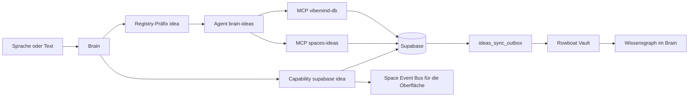
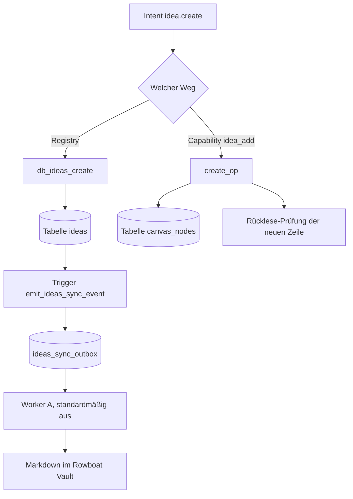

# Ideas

Stand: vibemind-os@3f5e15dab3e1, vibemind-os/voice@a506ca2e6452, vibemind-os/openfang@1d5f8967791f

## 1. Steckbrief

Der Space `ideas` verwaltet Ideen-Notizen innerhalb von Bubbles: anlegen, ändern, verknüpfen,
umformatieren und mit einem Sprachmodell erweitern. Er hat keinen eigenen Dienst mit Port. Die
Arbeit erledigen zwei MCP-Server und Operationen im Brain, die direkt auf Supabase schreiben.

- Zweck laut Routing-Registry: „Idea notes inside bubbles — create, update, link, format.“ [B1]
- Status: Code vorhanden. Ein Live-Lauf wurde in diesem Dokument nicht gemessen, und die Abdeckungsübersicht des Brain antwortet derzeit mit HTTP 500. [B1][B38]
- Agent: `brain-ideas`; Registry-Präfix `idea.`; Kontext `current_space`, `current_bubble`, `idea_titles` [B1]
- MCP-Server laut Registry: `vibemind-db` und `spaces-ideas`; von `spaces-ideas` ist nur `idea_connect` freigegeben [B1]
- `spaces-ideas` läuft über stdin/stdout (JSON-RPC), ohne Port, und bietet 13 Werkzeuge für Bubbles und Ideen [B3][B4][B5]
- `vibemind-db` meldet sich als `vibemind-db-supabase` 2.0.0, ebenfalls über stdin/stdout [B8]
- Die Agentenvorlage `brain-ideas` nennt als Modell `provider = "openai"`, `gpt-4o-mini` [B9]

## 2. Ecosystem Fit

`ideas` ist die Stelle, an der aus einem gesprochenen oder getippten Gedanken ein gespeicherter
Eintrag wird. Das Brain erreicht den Space auf zwei Wegen: über die Routing-Registry und den Agenten
`brain-ideas` oder über eine eigene Capability, die direkt Supabase anspricht. Änderungen an Bubbles
fließen über eine Warteschlange in den Rowboat-Wissensspeicher und von dort zurück in den
Wissensgraphen des Brain.

- Registry-Weg: Agent `brain-ideas` mit den MCP-Servern `vibemind-db` und `spaces-ideas` [B1][B9]
- Capability-Weg: `SupabaseExecutor` ordnet `supabase:idea.*` den Operationen in `supabase_ideas_ops.py` zu [B12]
- Nach jeder Operation meldet der Capability-Weg ein Ereignis an den Space Event Bus, den die Oberfläche liest [B16]
- Operationen, die ein Sprachmodell brauchen, laufen ausschließlich über die OpenFang-Rolle `brain_fast_reasoning` [B17]
- Jede Änderung an der Tabelle `ideas` löst einen Trigger aus, der in `ideas_sync_outbox` schreibt [B22][B23]
- Ein Worker überträgt die Warteschlange in Markdown-Dateien des Rowboat-Vault; er ist standardmäßig abgeschaltet [B24]
- Beim Start liest das Brain die Rowboat-Manifeste und legt Bubbles und Ideen in seinen Wissensgraphen [B25][B26]

## 3. Events

Die Registry führt 25 Events mit dem Präfix `idea.` [B2]. Für die meisten gibt es zusätzlich eine
Capability im Brain, die das Event auf einem anderen Weg ausführt [B12].

| Event | Auslöser | Was passiert | Ergebnis/Seiteneffekt | Beleg |
| --- | --- | --- | --- | --- |
| `idea.list` | Capability `idea_list` | Registry: `db_ideas_list` liest Tabelle `ideas`. Capability: `supabase:idea.list` | Liste der Einträge | [B2][B6][B29] |
| `idea.create` | Capability `idea_add` | Registry: `db_ideas_create` schreibt in `ideas`. Capability: `create_op` schreibt in `canvas_nodes` und liest die Zeile zurück | neue Zeile, je nach Weg in einer anderen Tabelle | [B2][B7][B10][B11] |
| `idea.update` | Capability `idea_update` | Registry: `db_ideas_update`, das `id` verlangt, während die Registry `idea_id` nennt. Capability: `supabase:idea.update` | geänderte Zeile | [B2][B6][B29] |
| `idea.delete` | Capability `idea_delete` | Registry: `db_ideas_delete`, gleiche Abweichung `id` gegen `idea_id`. Capability prüft, dass die Zeile danach fehlt | gelöschte Zeile | [B2][B6][B29] |
| `idea.find` | Capability `idea_find` | Registry: `db_ideas_list`, das nur `filter` kennt, während die Registry `query` nennt. Capability: `supabase:idea.find` | Trefferliste | [B2][B6][B29] |
| `idea.connect` | Capability `idea_connect` | Aufruf über den Agenten `brain-ideas` an `spaces-ideas`/`idea_connect`, nur mit `approval_ref` und `cost_ref` | neue Kante in `canvas_edges` | [B2][B13][B14][B15] |
| `idea.auto_link` | Capability `idea_auto_link` | Registry: `db_canvas_edge_create`. Capability: `supabase:idea.auto_link` | neue Kanten | [B2][B31][B36] |
| `idea.add_image` | nur Registry | `db_ideas_update`; das Schema hat kein Bildfeld | kein Handler für Bilder gefunden | [B2][B6][B40] |
| `idea.current_space` | nur Registry | `db_ideas_list` | Liste der Einträge | [B2][B6][B40] |
| `idea.format_table` | Capability `idea_format_table` | Registry: `db_ideas_update`. Capability: `idea_format_op` | Inhalt als Tabelle | [B2][B18][B30] |
| `idea.format_note` | Capability `idea_format_note` | wie `idea.format_table` | Inhalt als Notiz | [B2][B18][B30] |
| `idea.format_action_list` | Capability `idea_format_action_list` | wie `idea.format_table` | Inhalt als Aufgabenliste | [B2][B18][B30] |
| `idea.format_pros_cons` | Capability `idea_format_pros_cons` | wie `idea.format_table` | Inhalt als Pro/Contra | [B2][B18][B30] |
| `idea.format_hierarchy` | Capability `idea_format_hierarchy` | wie `idea.format_table` | Inhalt als Hierarchie | [B2][B18][B30] |
| `idea.format_specs` | Capability `idea_format_specs` | wie `idea.format_table` | Inhalt als Spezifikation | [B2][B18][B30] |
| `idea.convert_format` | Capability `idea_convert_format` | wie `idea.format_table` | Inhalt in anderem Format | [B2][B18][B30] |
| `idea.summarize` | nur Registry | `db_ideas_update` | kein eigener Handler gefunden | [B2][B40] |
| `idea.whitepaper` | nur Registry | `db_ideas_update` | kein eigener Handler gefunden | [B2][B40] |
| `idea.expand` | Capability `idea_expand` | `idea_llm_op` über das Sprachmodell | erweiterter Inhalt | [B2][B17][B18][B32] |
| `idea.explain` | Capability `idea_explain` | `idea_llm_op` über das Sprachmodell | Erklärtext | [B2][B18][B32] |
| `idea.analyze_links` | Capability `idea_analyze_links` | Registry: `db_canvas_nodes`. Capability: `idea_llm_op` | Analyse der Verknüpfungen | [B2][B33][B36] |
| `idea.explore.start` | nur Registry | `db_ideas_update` ohne Pflichtparameter | kein Handler gefunden | [B2][B40] |
| `idea.explore.stop` | nur Registry | `db_ideas_update` ohne Pflichtparameter | kein Handler gefunden | [B2][B40] |
| `idea.generate_doc` | nur Registry | `db_ideas_update` | kein Handler gefunden | [B2][B40] |
| `idea.to_project` | Capability `idea_to_project` | Registry: `db_projects_create`. Capability: `idea_to_project_op` | neue Zeile in `projects` | [B2][B34][B36] |

## 4. Datenverarbeitung

### Eingang

- Bubble anlegen über `db_ideas_create`: `title` (Pflicht), `description`, `source`, `tags` [B6]
- Idee in einer Bubble anlegen über `spaces-ideas`/`idea_create`: `bubble_id`, `title` (Pflicht), `content`, `node_type`, `x`, `y` [B39]
- Capability-Weg: freier Text des Intents; Titel und Inhalt werden daraus per Muster gelesen [B10][B11]

### Verarbeitung

- Der Capability-Weg ersetzt einen früheren direkten Aufruf, der am Import einer fehlenden `swarm`-Kette scheiterte [B10]
- `create_op` legt den Knoten an und prüft ihn anschließend per Rücklesen [B11]
- Die Supabase-Adresse und der Schlüssel werden erst beim Erzeugen des Clients gelesen, nicht beim Import [B27]

### Ausgang

- Tabelle `ideas` für Bubbles [B19]
- Tabelle `canvas_nodes` für Ideen-Notizen, verknüpft über `linked_idea_id` mit `ideas` [B20]
- Tabelle `canvas_edges` für Verknüpfungen [B21]
- Ereignisse auf dem Space Event Bus für die Oberfläche [B16]

### Speicherorte

- Supabase: `ideas`, `canvas_nodes`, `canvas_edges`, `projects`, `ideas_sync_outbox` [B19][B20][B21][B22]
- Markdown-Dateien im Rowboat-Vault, sofern der Sync-Worker eingeschaltet ist [B24]
- JSON-Manifeste unter `~/.rowboat/vibemind/ideas/` und deren Kopie im Wissensgraphen des Brain [B25][B26]

### Personenbezogene Daten

- Ja, möglich: `title` und `description` in `ideas` sind Freitext [B19]
- Ja, möglich: `title`, `content` und `summary` in `canvas_nodes` sind Freitext; hier stehen die eigentlichen Notizen [B20]
- Es gibt keine Spalte für einen Nutzer oder Eigentümer; `source` und `agent_id` bezeichnen die Herkunft, keine Person [B19][B20]
- Kopien der Inhalte liegen zusätzlich als Dateien im Benutzerverzeichnis und im Wissensgraphen [B24][B25][B26]

## 5. Roadmap

Für `ideas` gibt es keine eigene belegte Roadmap. Der einzige Plan, der den Space weiterentwickelt,
koppelt ihn an den Research-Space.

- Als Nächstes: Kopplung Research ↔ Ideas, beschrieben als Spec [B37]

## 6. Umsetzungsstand und Grenzen

- Zwei Wege schreiben in verschiedene Tabellen: Die Registry legt Einträge in `ideas` an, die Capability in `canvas_nodes`. Welcher Weg greift, hängt vom Routing ab. [B2][B7][B10][B11]
- Parameternamen der Registry passen nicht zu den Tools: `idea_id` statt `id`, `query` statt `filter` [B2][B6]
- Sieben Registry-Events haben keine Capability im Brain: `add_image`, `current_space`, `summarize`, `whitepaper`, `explore.start`, `explore.stop`, `generate_doc`. Sie laufen nur über das allgemeine Registry-Tool; `add_image` hat dort kein Bildfeld [B2][B6][B40]
- Umgekehrt gibt es Capabilities ohne Registry-Event, etwa `idea_disconnect`, `idea_move`, `idea_count`, `idea_link_to_root`, `idea_classify`, `idea_create_batch` [B32][B35]
- `bubble.enter` ist auf dem direkten Weg ein weicher Leerlauf, der nie hart scheitert [B28]
- Der Sync-Worker in den Rowboat-Vault ist standardmäßig abgeschaltet [B24]
- Die Agentenvorlage nennt einen OpenAI-Anbieter, obwohl ausschließlich über die Subscription gearbeitet wird [B9]
- Die Abdeckungsübersicht `/api/events/mapping` antwortet mit HTTP 500 [B38]

## 7. Belege

- B1: datei vibemind-os/config/space_agent_registry.yml:62-70
- B2: datei vibemind-os/config/space_agent_registry.yml:71-100
- B3: datei vibemind-os/spaces/ideas/mcp_server.py:22-24
- B4: datei vibemind-os/spaces/ideas/mcp_server.py:94-181
- B5: datei vibemind-os/spaces/ideas/mcp_server.py:816-822
- B6: datei vibemind-os/voice/python/vibemind_db_mcp.py:64-81
- B7: datei vibemind-os/voice/python/vibemind_db_mcp.py:246-259
- B8: datei vibemind-os/voice/python/vibemind_db_mcp.py:461-484
- B9: datei vibemind-os/openfang/agents/brain-ideas/agent.toml:1-11
- B10: datei vibemind-os/brain/the_brain/data/capabilities.yaml:538-573
- B11: datei vibemind-os/brain/the_brain/core/supabase_ideas_ops.py:293-430
- B12: datei vibemind-os/brain/the_brain/core/capability_targets.py:1636-1721
- B13: datei vibemind-os/brain/the_brain/core/capability_targets.py:1140-1187
- B14: datei vibemind-os/brain/the_brain/data/capabilities.yaml:694-713
- B15: datei vibemind-os/spaces/ideas/mcp_server.py:738-768
- B16: datei vibemind-os/brain/the_brain/core/supabase_ideas_ops.py:121-134
- B17: datei vibemind-os/brain/the_brain/core/supabase_ideas_ops.py:587-600
- B18: datei vibemind-os/brain/the_brain/core/supabase_ideas_ops.py:1224-1330
- B19: datei vibemind-os/supabase/migrations/20260411_init_vibemind.sql:11-25
- B20: datei vibemind-os/supabase/migrations/20260411_init_vibemind.sql:66-77
- B21: datei vibemind-os/supabase/migrations/20260411_init_vibemind.sql:84-89
- B22: datei vibemind-os/supabase/migrations/20260610_ideas_sync_triggers.sql:29-40
- B23: datei vibemind-os/supabase/migrations/20260610_ideas_sync_triggers.sql:48-89
- B24: datei vibemind-os/voice/python/publishing/bubble_sync/worker_db_to_fs.py:17-43
- B25: datei vibemind-os/brain/the_brain/core/rowboat_reader.py:79-92
- B26: datei vibemind-os/brain/the_brain/web/brain_server.py:1361-1395
- B27: datei vibemind-os/brain/the_brain/core/supabase_ideas_client.py:45-70
- B28: datei vibemind-os/brain/the_brain/core/supabase_ideas_ops.py:250-291
- B29: datei vibemind-os/brain/the_brain/data/capabilities.yaml:1281-1380
- B30: datei vibemind-os/brain/the_brain/data/capabilities.yaml:732-1033
- B31: datei vibemind-os/brain/the_brain/data/capabilities.yaml:1034-1060
- B32: datei vibemind-os/brain/the_brain/data/capabilities.yaml:659-731
- B33: datei vibemind-os/brain/the_brain/data/capabilities.yaml:1481-1503
- B34: datei vibemind-os/brain/the_brain/data/capabilities.yaml:575-594
- B35: datei vibemind-os/brain/the_brain/data/capabilities.yaml:1382-1558
- B36: datei vibemind-os/voice/python/vibemind_db_mcp.py:111-137
- B37: datei vibemind-os/docs/superpowers/specs/2026-09-16-research-bubble-kopplung-design.md
- B38: messung 2026-09-24 GET http://localhost:5000/api/events/mapping ergab HTTP 500
- B39: datei vibemind-os/spaces/ideas/mcp_server.py:110-124
- B40: datei vibemind-os/brain/the_brain/data/capabilities.yaml
